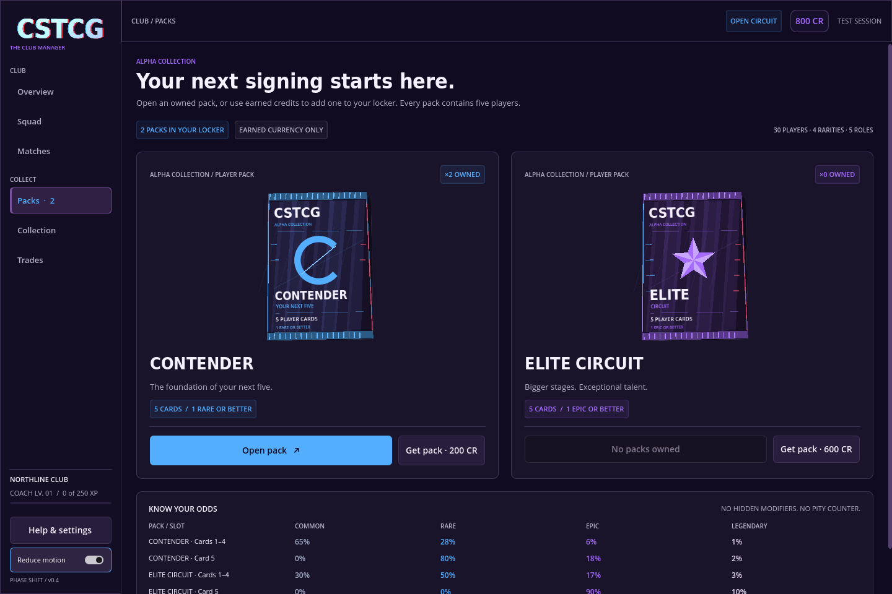

# CSTCG · Club Circuit

A playable Godot 4 prototype for a Counter-Strike-inspired team manager with collectible player cards, pack-opening rewards, and local trading.

For portable builds and a short test walkthrough, see [TESTING.md](TESTING.md). The source project ZIP opens in Godot 4.6.3; the Windows/Linux portable builds run without the editor.

**Open packs → build a five-player lineup → choose tactics → play the circuit → earn your next signing.**

Alpha 0.5 adds **pack-specific card backs, per-copy origin tracking, an animated front/back inspector and source-aware lineup/release controls**. See [the current build notes](docs/CARD_BACKS_0_5.md). The [slow tear and explosive opening](docs/OPENING_EFFECTS_0_4_1.md), [Phase Shift update](docs/ALPHA_0_4.md) and [Dust II match rules](docs/ALPHA_0_2.md) remain included. HLTV headshots await the saved environment network-access update; this build retains the neutral identity art.

The next launch collection is specified in the [CSTCG Series 1 design kit](docs/series_1/DESIGN_SPEC.md): Alpha, Bravo, Elite and Beta Event, each with a 50-card pool. Browse the [interactive 90-card catalogue](docs/series_1/index.html) or the [printable lookbook](docs/series_1/CSTCG_Series_1_Design_Lookbook.pdf). These are content/art specifications; the playable alpha catalogue is unchanged.



## Play

Requires **Godot 4.6.3 standard**; the cloud environment already includes it. Uses GDScript, with no external packages, credentials, or backend services.

In the cloud environment, use writable Godot data directories:

```bash
export XDG_CACHE_HOME=/workspace/.cache
export XDG_CONFIG_HOME=/workspace/.config
export XDG_DATA_HOME=/workspace/.local/share
mkdir -p "$XDG_CACHE_HOME" "$XDG_CONFIG_HOME" "$XDG_DATA_HOME"
cd /workspace/CSTCG
godot --editor --path .
```

Press **F6/F5** to play the current/main scene, or run `godot --path .` directly. Graphical play requires a desktop display. On your own desktop, import `project.godot` through Godot's project manager; the cloud-specific XDG paths are unnecessary.

You start with a complete lineup, one spare YEKINDAR, **800 credits**, and **two Contender packs**. Open **Packs**, reveal a pack, then use **Squad** to add a new player. **Help & settings** explains the full loop and opens the map tools.

## Included

- Six connected screens: Overview, Squad, Packs, Collection, Matches, and Trades, grouped into club and collection navigation.
- Thirty real public player identities across five assigned roles and four rarities, with custom alpha stats and neutral nameplates.
- Contender and Elite packs, selected 3D previews, physical foil wrappers, animated seam tearing/card fans/flips, richer premium effects, duplicate/NEW labels, guaranteed slots, and published odds.
- Roster substitutions, searchable/sortable collection filters, foil player inspection with role-starter comparison, spare-card releases, and confirmed one-for-one AI trades.
- A pre-match choice: play an automatic 3D Dust II match for full rewards, or use the quick simulation for half credits/XP. Both support MR12/MR3 overtime, saved reports and milestone packs.
- Transactional local saves; pack reveals resume with their original contents, and played matches resume from the current round’s start without rerolling it. Earlier clubs migrate with a backup.
- Saved reduced-motion, 3D-preview and pack-sound preferences, visible keyboard focus, Escape-to-close dialogs, and layouts that resize without shrinking the text.
- A [Dust II 3D map lab](docs/MAP_INTEGRATION.md) using the supplied STL, with navigation, collision-checked movement probes, and eye-height sightline tools. Open it from **Help & settings → Open 3D map lab** or run `godot --path . --scene res://scenes/spatial_lab.tscn`.

Read the reconciled [Master GDD v3.0](docs/ESPORTS_CSTCG_Master_GDD_v3_0.md) for the recommended full game: Ultimate Team-style collecting combined with tactical club management. [Merge notes](docs/DESIGN_MERGE_NOTES.md) identify changes to the old design. The [alpha 0.2 notes](docs/ALPHA_0_2.md) document the current match rules and real-player roster. The [older prototype specification](docs/GAME_DESIGN.md) is historical; the master GDD is a design proposal, not an implemented feature list. [Architecture](docs/ARCHITECTURE.md) explains the existing code.

The master is also available as a [PDF](docs/ESPORTS_CSTCG_Master_GDD_v3_0.pdf) and an [editable Word document](docs/ESPORTS_CSTCG_Master_GDD_v3_0.docx). Run `python3 tools/export_gdd.py` to regenerate these from Markdown in a document-authoring environment with `reportlab` and `python-docx`; these packages are not game dependencies.

## Verify

```bash
bash tools/check.sh
```

This imports the project, runs deterministic gameplay/state tests, exercises UI button flows, checks the 3D map's routes/collision/sightlines, and runs causal matches with resume, combat, objective and overtime scenarios. It uses temporary writable data directories and leaves your club save untouched. The script fails on command failures, Godot error output, or a missing completion marker.

Individual checks, after setting the cloud XDG directories above:

```bash
godot --headless --path . --editor --import
godot --headless --path . --script res://tests/test_game.gd -- --ephemeral
godot --headless --path . -- --ephemeral --ui-smoke
godot --headless --path . --fixed-fps 60 --quit-after 2200 -- --ephemeral --pack-smoke
godot --headless --path . --script res://tests/test_spatial.gd -- --ephemeral
godot --headless --path . --quit-after 900 -- --ephemeral --spatial-smoke
godot --headless --path . --script res://tests/test_live_match.gd -- --ephemeral
godot --headless --path . --quit-after 900 -- --ephemeral --live-match-smoke
```

For visual capture on an **existing graphical display**:

```bash
godot --path . --audio-driver Dummy -- --ephemeral --ui-smoke --capture-dir=/tmp/cstcg-captures
```

Use `--ephemeral` for experiments without loading or changing your saved club. Normal play saves under `user://club_v1.json`; with the cloud paths above, this is `/workspace/.local/share/godot/app_userdata/CSTCG · Club Circuit/club_v1.json`. An unreadable save is preserved and the session becomes unsaved; back up the file before replacing it.

## Scope

This is an **offline alpha**. The played match runs ten agents, combat, equipment and bomb objectives on Dust II; the skip path retains the aggregate round simulator with 50% credits/XP. See [alpha 0.2](docs/ALPHA_0_2.md) for mechanics and limits. Trades use local AI managers. Online trading, paid currency and ranked services remain future work. HLTV portrait preparation awaits environment network access and the jersey-edit review. Real names use custom game roles/ratings and neutral portrait placeholders. Card/pack graphics are original; map geometry is the user-supplied STL. This project is not affiliated with Valve or the players. Native Windows hardware testing still relies on tester feedback.

The supplied 26-page [v2.0 master GDD](docs/reference/ESPORTS_CSTCG_Master_GDD_v2_0.pdf) has now been reconciled with the prototype into v3.0. The original is preserved unchanged. The older conversation link itself was unavailable; this merge uses the actual supplied PDF.

Bundled font notices are in [assets/fonts](assets/fonts/). No game-source license has been chosen.
