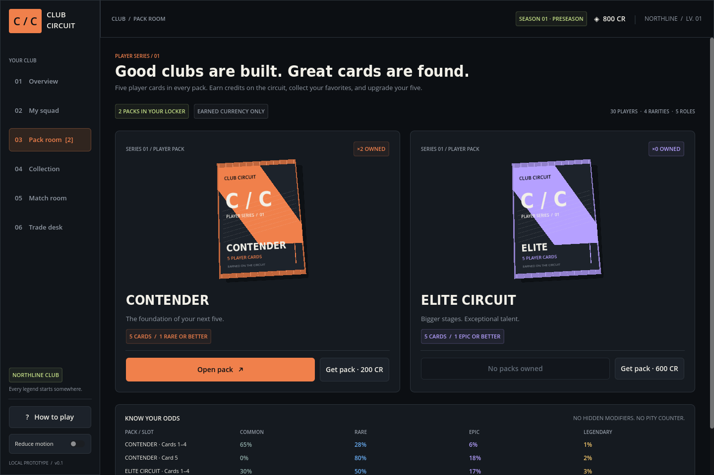

# CSTCG · Club Circuit

A playable Godot 4 prototype for a Counter-Strike-inspired team manager with collectible player cards, pack-opening rewards, and local trading.

For portable builds and a short test walkthrough, see [TESTING.md](TESTING.md). The source project ZIP opens in Godot 4.6.3; the Windows/Linux portable builds run without the editor.

**Open packs → build a five-player lineup → choose tactics → play the circuit → earn your next signing.**



## Play

Requires **Godot 4.6.3 standard**; the cloud environment already includes it. Uses GDScript, with no external packages, credentials, or backend services.

In the cloud environment, use writable Godot data directories:

```bash
export XDG_CACHE_HOME=/workspace/.cache
export XDG_CONFIG_HOME=/workspace/.config
export XDG_DATA_HOME=/workspace/.local/share
mkdir -p "$XDG_CACHE_HOME" "$XDG_CONFIG_HOME" "$XDG_DATA_HOME"
cd /workspace/CSTCG
godot --editor --path .
```

Press **F6/F5** to play the current/main scene, or run `godot --path .` directly. Graphical play requires a desktop display. On your own desktop, import `project.godot` through Godot's project manager; the cloud-specific XDG paths are unnecessary.

You start with a complete lineup, one spare SPARK, **800 credits**, and **two Contender packs**. Start in Pack room, open a pack, then use My squad to add a new player. The in-game **How to play** screen explains the full loop.

## Included

- Six connected screens: Overview, My squad, Pack room, Collection, Match room, and Trade desk.
- Thirty fictional player cards across five roles and four rarities, with illustrated portraits and visible stats.
- Contender and Elite packs, sealed wrappers, a tear-open transition, sequential reveals, duplicate/NEW labels, guaranteed slots, and published odds.
- Roster substitutions, collection filters, spare-card releases, and confirmed one-for-one AI trades.
- MR12 match simulation, MR3 overtime, map/tactic modifiers, equipment budgets, round feed, match history, credits, XP, and milestone packs.
- Transactional local saves; interrupted pack openings resume with their original contents.
- A reduced-motion switch, mouse and keyboard button navigation, and responsive viewport scaling.
- A [Dust II 3D map lab](docs/MAP_INTEGRATION.md) using the supplied STL, with navigation, collision-checked movement probes, and eye-height sightline tools. Open it from Match room or run `godot --path . --scene res://scenes/spatial_lab.tscn`.

Read the reconciled [Master GDD v3.0](docs/ESPORTS_CSTCG_Master_GDD_v3_0.md) for the recommended full game: Ultimate Team-style collecting combined with tactical club management. [Merge notes](docs/DESIGN_MERGE_NOTES.md) identify changes to the old design. The [prototype specification](docs/GAME_DESIGN.md) documents the current build's actual rules; the new GDD is a design proposal, not an implemented feature list. [Architecture](docs/ARCHITECTURE.md) explains the existing code.

The master is also available as a [PDF](docs/ESPORTS_CSTCG_Master_GDD_v3_0.pdf) and an [editable Word document](docs/ESPORTS_CSTCG_Master_GDD_v3_0.docx). Run `python3 tools/export_gdd.py` to regenerate these from Markdown in a document-authoring environment with `reportlab` and `python-docx`; these packages are not game dependencies.

## Verify

```bash
bash tools/check.sh
```

This imports the project, runs deterministic gameplay/state tests, exercises UI button flows, and checks the 3D map's routes/collision/sightlines. It uses temporary writable data directories and leaves your club save untouched. The script fails on command failures, Godot error output, or a missing completion marker.

Individual checks, after setting the cloud XDG directories above:

```bash
godot --headless --path . --editor --import
godot --headless --path . --script res://tests/test_game.gd -- --ephemeral
godot --headless --path . -- --ephemeral --ui-smoke
godot --headless --path . --script res://tests/test_spatial.gd -- --ephemeral
godot --headless --path . --scene res://scenes/spatial_lab.tscn --quit-after 900 -- --ephemeral --spatial-smoke
```

For visual capture on an **existing graphical display**:

```bash
godot --path . --audio-driver Dummy -- --ephemeral --ui-smoke --capture-dir=/tmp/cstcg-captures
```

Use `--ephemeral` for experiments without loading or changing your saved club. Normal play saves under `user://club_v1.json`; with the cloud paths above, this is `/workspace/.local/share/godot/app_userdata/CSTCG · Club Circuit/club_v1.json`. An unreadable save is preserved and the session becomes unsaved; back up the file before replacing it.

## Scope

This is an **offline prototype**. Trades are with local AI managers. The Dust II scene is a geometry/navigation test lab; it does not yet run combat, bomb objectives, or the match engine. The management game's match events remain an aggregate simulation with descriptive commentary. Online marketplace, paid currency, ranked service, and licensed player imagery remain future work. Portable export presets and test instructions are included; native Windows hardware coverage is still limited to tester feedback. Players and card/pack art are fictional/original; map geometry is the user-supplied STL. This project is not affiliated with Valve.

The supplied 26-page [v2.0 master GDD](docs/reference/ESPORTS_CSTCG_Master_GDD_v2_0.pdf) has now been reconciled with the prototype into v3.0. The original is preserved unchanged. The older conversation link itself was unavailable; this merge uses the actual supplied PDF.

Bundled font notices are in [assets/fonts](assets/fonts/). No game-source license has been chosen.
