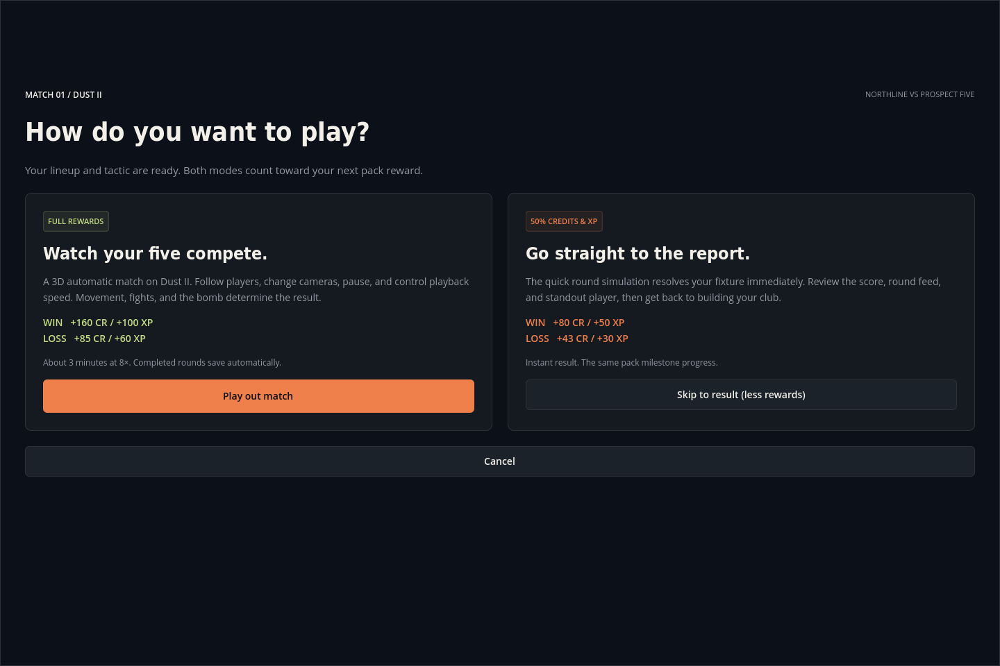
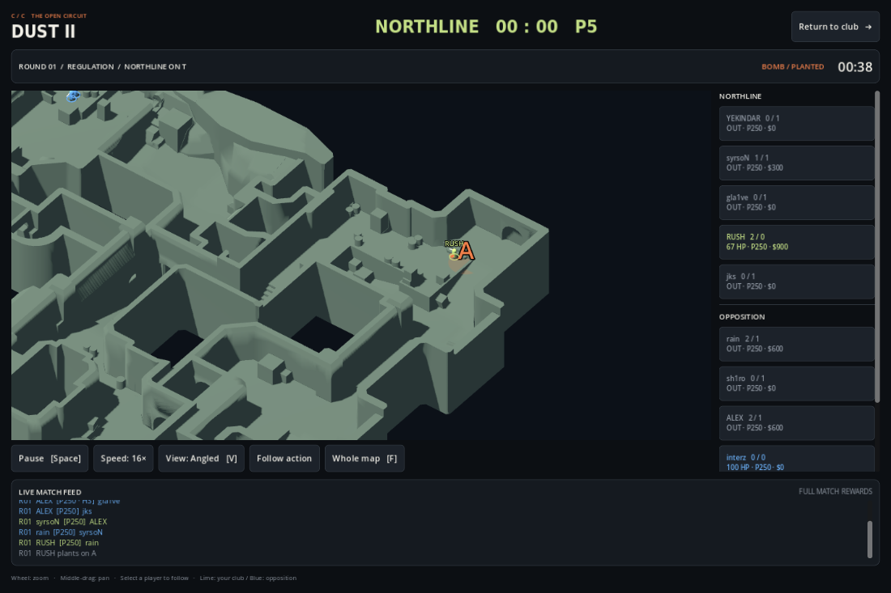

# Dust II alpha 0.2

Every new fixture opens a choice before any result or reward is created.

| Choice | Match behavior | Win | Loss |
| --- | --- | --- | --- |
| Play out match | Automatic ten-agent 3D match on the supplied Dust II model | 160 CR / 100 XP | 85 CR / 60 XP |
| Skip to result (less rewards) | Existing aggregate round simulation; immediate saved report | 80 CR / 50 XP | 43 CR / 30 XP |

Both completed modes advance the same pack milestones: a Contender every four matches, plus an Elite every twelve. Half-credit rewards round to the nearest whole credit. Reports and repeat completion calls do not award again. Cancelling the choice preserves the fixture.

## Played match

Dust II is the only selectable alpha map. `SpatialMatchSim` runs fixed 0.1-second ticks, independent of playback speed or rendering. Round winners follow agent actions and the bomb, rather than being selected in advance. The match uses MR12, a side switch after twelve rounds, and MR3 overtime. After six tied overtimes, one played deciding round bounds the match at 61 rounds.

Ten frozen card profiles supply Aim, Game Sense and Utility. Agents buy affordable weapons, armor and utility, retain surviving equipment, earn kill/round money, reload, and react to what they see. Eye-height rays query actual map collision; smoke blocks sight, flashes require distance/facing/clear geometry, and audible fire supplies a direction rather than permission to hit hidden targets. The alpha supports pistols, SMGs, rifles and AWPs with simplified tuning.

Teams attack a seeded A/B site and defenders split between sites with a mid player. Fast Execute moves faster and favors B. Map Control delays the setup and sends an attacking lurker through mid. Balanced uses the regular pace. These are basic automatic plans, not a CS2 bot implementation or an interactive tactical command system.

The bomb has a carrier, can drop and be recovered by a living teammate, takes 3.2 seconds to plant inside a supported site volume, and explodes after 40 seconds. Defuse takes ten seconds or five with a purchased kit. Defusing, detonation, elimination, and the unplanted round clock determine the winner. A planted bomb remains live when all attackers die.

The viewer starts with an angled camera following the action. Select a player to follow, switch overhead/angled views, choose Whole map, zoom/pan, pause, or cycle 1×–16× speed. Default 8× playback takes roughly two to four minutes for a typical match; this varies with rounds and hardware. All players are visible to the spectator.

## Persistence

Starting a played match atomically saves its ID, seed, opponent, lineup, strategy and full card profiles. Collection and strategy changes stay locked until that fixture finishes. Completed rounds save score, individual equipment/cash, accumulated statistics and significant events. Closing or returning to the club resumes from the start of the current round. The seed resets deterministically per round, so interruption does not reroll an outcome.

The final result, credits, XP, milestone packs and cleared pending fixture commit together. If a checkpoint or final save fails, playback pauses and offers Retry save. The completed match cannot be left with unsaved rewards. This is local offline persistence, not tamper-proof online authority.

Schema 1 clubs migrate to schema 2 in the same `club_v1.json` location. Before writing the migrated save, the original bytes are retained as `club_v1.json.before-alpha2.bak`. All thirty former card IDs map one-for-one to real identities, retaining quantities, lineup, wallet, XP, packs and reveal state. Historical maps stay named in their old reports, while future fixtures use Dust II.

## Real player identities

The thirty cards now use real public handles, names and countries across several eras. Roles, rarity, stats, collection series and opponent mixes are custom alpha game content. They do not represent current contracts, current organizations, official rankings, or an endorsed roster. Existing common cards keep their game strength when their identity changes.

Portraits are optional local resources at `assets/players/<id>.jpg`. This build uses neutral monograms because no verified photographic assets were available through the environment's network policy. It does not present generated lookalikes as real photographs. Add suitably sourced portraits with their license and attribution before packaging them; a path alone is not permission to redistribute an image.

## Limits and next work

The uploaded STL remains the source for render, static collision and navigation. The scale and landmark semantics are provisional. Match formations derive five supported positions at each spawn, and plant volumes are authored radius-2.8, height-tolerance-0.75 regions around the supported A/B seeds. These are alpha gameplay zones, not official CS2 map semantics.

Physical travel tracks are generated from native navigation and validated through the same floor/capsule/sweep checks as the spatial lab, then cached for this static world. Agents stop on failed routes; they never teleport across geometry. Agent-to-agent collision avoidance, dynamic doors, penetration, recoil patterns, precise grenade physics, equipment pickup, first-person control and official CS2 timing remain future work. The spatial lab is still available separately for geometry inspection and never grants rewards.

`tests/test_live_match.gd` covers a complete causal fixture, clear-ray shots, geometry clearance, a serialized round-boundary resume, full settlement and duplicate prevention. Targeted scenarios cover blocked stale sightings, smoke occlusion, illegal plants, completed plants, defuse timing, dropped-bomb pickup, posthumous detonation, timeout and causal overtime. Existing state tests cover schema migration and an exact original-file backup. Portable export checks exercise both match choices through the real menu and the full 3D scene.
