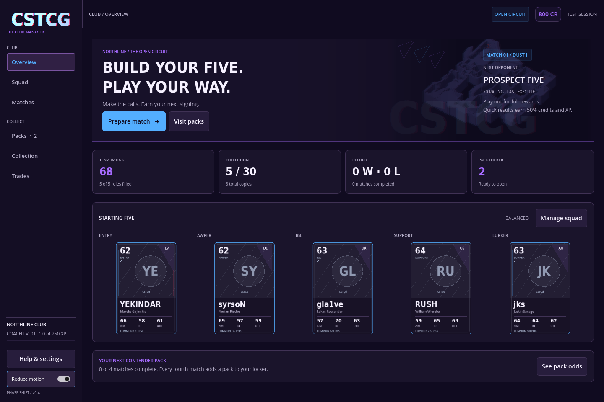
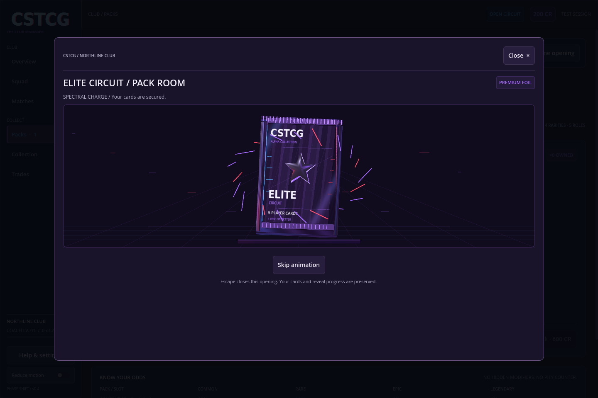

# Alpha 0.4 · Phase Shift

This build implements the approved visual milestones A–C from the [Phase Shift proposal](proposals/PHASE_SHIFT_INTEGRATION.md): the blue/red/violet theme, physical collectible presentation, animated pack opening, card comparison and connected reward visuals. The four Series 1 products remain a separate content release.

## What changed

- Plum-black menus, ice-blue actions/focus, violet branding and signal-red opponent/loss accents. The menu wordmark is rendered from actual extruded typography with blue/red edge layers.
- Blue Contender and violet Elite Circuit wrappers share a dimensional pouch, separate tearable crimp, foil materials and physical card meshes. Collection/squad grids retain lightweight 2D cards.
- Clicking a locker wrapper opens its selected 3D preview with price, owned quantity, exact odds and guarantee. Inspecting does not consume a pack.
- Player inspection shows a foil card with cursor tilt and its three real alpha attributes beside the current role starter's values and signed differences.
- Match reports show the actual awarded milestone pack using the same wrapper artwork. Reopening a report grants nothing again.

## Standard versus premium opening

| Treatment | Contender · 200 earned CR | Elite Circuit · 600 earned CR |
| --- | --- | --- |
| Identity | Blue foil, printed C | Violet foil, raised faceted metal crest |
| Anticipation | Short blue seam charge | Longer spectral charge and stronger light response |
| Fragments | 8 displaced orbiting elements | 20 orbiting elements and denser chromatic trails |
| Tear and fan | Separate crimp leaves, wrapper drops, five concealed cards fan out | Longer preparation, more rotation and stronger flourish before the same five-card fan |
| Card flips | Fast physical turns with rarity-dependent accent | Additional lift/pulse and slightly longer rarity-dependent holds |
| Sound | Original foil tear and card contact | Original harmonic charge, foil tear and card contact |

The more elaborate pack treatment is visual. Prices, eligible players, rarity odds, guaranteed slots and rewards are unchanged. Every concealed card uses the same back and neutral edge material. Higher-rarity reveal accents are applied only to the secured real result.

## Opening controls and persistence

Open an owned pack, select **Tear open**, then reveal individually or select **Reveal all**. **Skip animation** ends the current visual transition immediately. It never rolls another result or reveals unrequested cards: skipping the tear goes to concealed sleeves; skipping a committed reveal shows its committed target.

The existing `Game.open_pack` transaction secures all contents before presentation begins. A reveal is committed before its flip. Closing during tear, fan or flip destroys the presentation tween; resuming uses the exact saved cards and reveal count. Inspect a revealed card and choose **Back to opening** to return without losing progress. Finishing the opening unlocks lineup changes.

**Reduce motion** retains still foil art and immediate transitions. **Help & settings** also offers **3D collectible previews** and **Pack sound effects** toggles. Disabling 3D uses an actual lightweight 2D fallback. Preferences are stored separately from club state; ephemeral tests neither read nor write them.

## Try it

1. Open **Packs** and click a wrapper to inspect it in 3D.
2. Open a starter Contender, tear it and watch a single reveal. Close midway and resume it.
3. On a fresh club, the initial 800 CR can buy one 600 CR Elite Circuit pack. Open it to compare the spectral charge, crest, fragments and sound.
4. Reveal all, inspect a signing, compare it with your role starter, return to the opening and choose **Build your five**.
5. Try reduced motion, muted pack sounds and 2D previews. Reopen the app to confirm preferences persist.

## Implementation and verification

`CollectibleStage` owns visual meshes, a local viewport, printed foil materials and cancellable tweens. `PackOpening` owns presentation controls and reads secured club data. Neither consumes the gameplay RNG. Material effects stay away from names and numbers. The current GL Compatibility renderer is retained.

The state, migration, map, causal-match and existing UI suites remain required. The new `--ephemeral --pack-smoke` path additionally exercises both visual profiles, normal and skipped reveals, duplicate input protection, mid-opening inspection, interrupted flip resume, reduced motion, bundled audio and the lightweight fallback. Run it with `--fixed-fps 60 --quit-after 2200` for repeatable presentation timing. Graphical review verifies actual meshes and shader rendering; headless checks exercise the same state transitions through the fallback.

Exports now have eight checks: manager, map, pack presentation and live match for both the Linux executable and Windows resource pack. Native Windows execution still requires a Windows tester.

## Catalogue boundary

The playable build still has thirty identities, four alpha rarities and two five-card products. It does not install the Series 1 sixty-player/ninety-definition collection, three-card products, edition model or eight-attribute behavior changes. Existing club saves use the same schema and keep their cards, packs, credits, history and pending fixture/reveal data. The revised Series 1 pack-family concept is included with the approved proposal for the later catalogue milestone.
