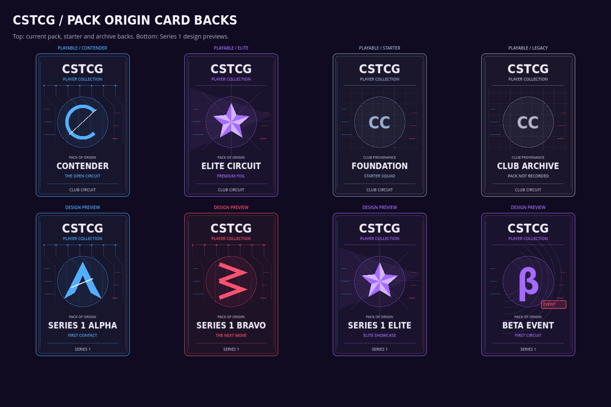
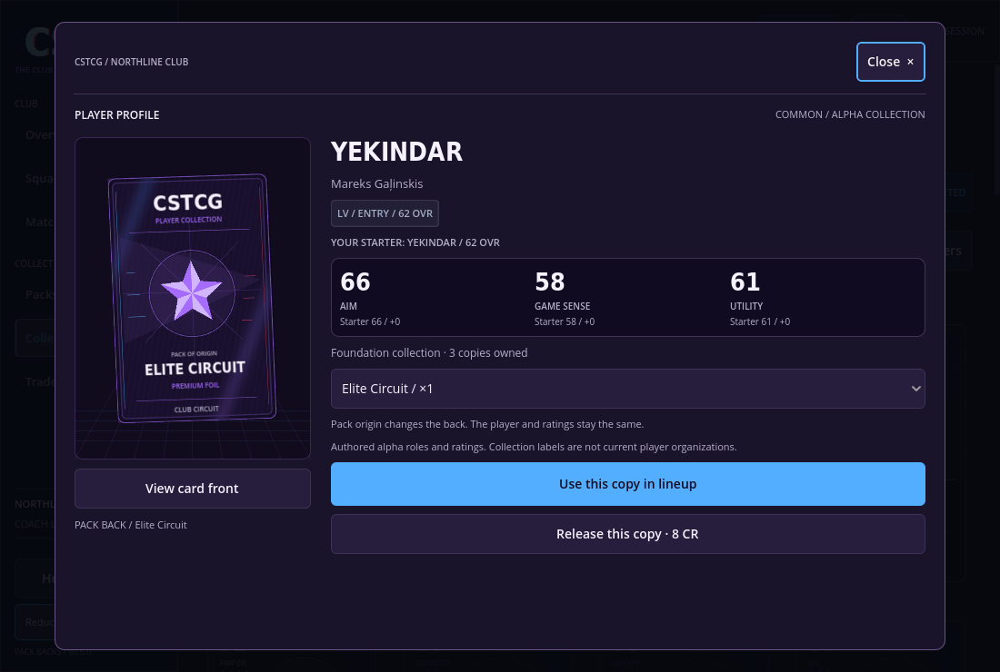

# Alpha 0.5 · Pack-origin card backs

Each collectible copy now retains its originating pack independently of its player definition. A player pulled from Contender has the blue circuit/C back; the same player pulled from Elite Circuit has the violet faceted-crest back. Their ratings and role remain identical.

## Artwork and controls

- **Contender:** blue circuit traces, split circular emblem and a clean printed footer.
- **Elite Circuit:** violet facets, a raised-looking star crest, stronger foil and matching product identification.
- **Foundation:** a subdued starter-squad back for new-club cards.
- **Archive:** a neutral back marked PACK NOT RECORDED for cards whose previous source was never saved. Local AI trade acquisitions without supplied origin stay explicitly unrecorded.
- **Series 1 proofs:** Alpha, Bravo, Elite and Beta Event also have distinct back artwork in the design sheet. Those four products remain design previews; the live catalogue is still the two alpha packs.

All concealed cards in an opening share its pack back. No individual name, stat, rarity or identity is printed on that back. The 3D opening, lightweight fallback, card inspector and resumed openings use the same source data.

Open a player profile, select an owned source in the dropdown, then choose **View card back** or **View card front**. The 3D inspector flips the card; reduced motion and lightweight mode update immediately. If multiple copies have different backs, select the desired copy before **Use this copy in lineup** or **Release this copy**. One copy with the lineup's exact origin remains protected. Merely switching views does not alter the club.

## Inventory and saves

Schema 3 adds per-player origin quantities and the five active copy origins. Aggregate inventory quantities, identities, prices, odds and match calculations remain unchanged. Acquisitions and removals update both counts in the same transaction, and a failed save restores both. A source change cannot improve player strength or field another copy of the same professional.

Existing schema-2 saves are backed up byte-for-byte as `club_v1.json.before-card-backs.bak` before migration. Currency, inventories, history, active match snapshots and pending reveals are retained. Completed old pulls did not record provenance, so they receive Archive backs. The exact cards in an unfinished pack can still be attributed to its saved pack ID. Old schema-1 saves continue through the existing identity migration and keep their `.before-alpha2.bak` original backup.

Validation rejects an origin ledger whose totals differ from inventory, an unknown origin, or a lineup copy without a matching owned source. Tests cover mixed pack copies, same-player source changes, active-copy protection, exact release, trades, pending duplicates, rollback and migration roundtrips.

## Player photos

The user authorized HLTV headshots with team branding removed or plain-color jerseys. The attempted request was blocked by the cloud's network policy with a proxy CONNECT 403. No photographic portraits are bundled in this build. Existing monograms remain until real source images can be fetched, edited and reviewed.

A saved environment configuration draft adds only `hltv.org`, `www.hltv.org` and `img-cdn.hltv.org`. It needs review/save/publish in environment settings to become active. The draft save is confirmed; it does not itself grant access.

`tools/fetch_hltv_portraits.py --list` prepares the thirty candidate profile URLs without network calls. On a permitted fetch, it verifies the fetched nickname, accepts only a player bodyshot, validates the image type and records source URLs/hashes. Raw images stay outside the game for identity and plain-jersey editing review. Reviewed PNG cutouts go in `assets/players/`; legacy JPEGs remain supported. The foil shader now protects the entire portrait rectangle so darker hair or skin does not receive the foil color effect.

Regenerate the artwork sheet on a graphical display with `godot --path . --script res://tools/capture_card_back_gallery.gd -- --ephemeral`. This captures the actual procedural card-back renderer rather than a nonfunctional mockup.
