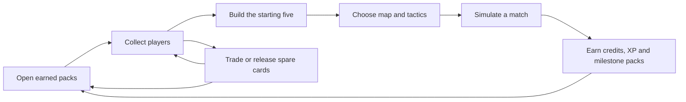

# CSTCG · Club Circuit

**Game design v0.1 — working prototype and full-game direction**

> Historical prototype specification. The reconciled design recommendation is now [Master GDD v3.0](ESPORTS_CSTCG_Master_GDD_v3_0.md), which incorporates the supplied v2.0 PDF. The rules below describe the earlier playable prototype and are retained for implementation reference; references to an unavailable earlier draft reflect when this file was written.

## 1. The game in one paragraph

Build a Counter-Strike-inspired esports club through a collection of player cards. Open earned packs, discover new talent, assemble a balanced five, and make the tactical decisions that turn potential into results. Matches are readable management simulations rather than first-person action. Spare cards become trade opportunities; match rewards bring the player back to the pack room. The collection and simulation form one continuous game.

Working identity: **Club Circuit**. Repository/project identity: **CSTCG**. Desktop-first, Godot 4, GDScript, single-player first. Real players, organizations, logos, and licensed imagery are not assumed. The initial thirty-player set and all club identities are fictional.

This document develops the requirements provided in the current chat. The linked earlier draft was unavailable; its specific content has not been silently treated as reviewed or incorporated.

## 2. Design pillars

1. **A club to care about.** Each card is a recognizable player with a role, club, identity, and useful attributes. Substitutions are management decisions rather than a constant search for a single large number.
2. **Packs are a core experience.** Sealed wrappers, readable guarantees, a deliberate opening, and a satisfying five-card reveal belong alongside the simulation, not in a secondary menu added later.
3. **Understand the result.** The player sees the opposition, tactical approach, map affinity, round scores, and equipment budgets. Better decisions should have visible explanations.
4. **Every session progresses.** Defeats still earn credits and XP. Cards do not expire, disappear after matches, or require repairs. Players can always return to the circuit.
5. **Collecting has practical uses.** A new card can improve a role, create a club pairing, complete a collection goal, or become a trade. Duplicate handling is designed from the beginning.

## 3. The playable loop

The first session starts with a complete five-role lineup, a spare card, 800 credits, and two Contender packs. The player can open packs immediately, accept a starter trade, or play with the original team. No tutorial choice can strand the account without a legal lineup.

A normal short session is: open a pack, make one substitution, scout the next opponent, choose a tactic, watch or skip the match report, and decide how to spend the reward. The prototype plays reports quickly; the eventual career should support longer, more deliberate sessions without forcing players to watch repeated animations.

## 4. Screens and information hierarchy

| Screen | Primary job | Main action |
| --- | --- | --- |
| Overview | Understand the club at a glance: lineup, rating, record, collection, locker, next fixture | Prepare the next match |
| My squad | Compare the active five with available substitutes | Replace a player in the same role |
| Pack room | See owned packs, prices, guarantees, and exact odds | Acquire and open a pack |
| Collection | Browse owned cards or the complete set; filter by rarity/role | Equip or release a card |
| Match room | Scout the opponent; choose map and tactic; review previous results | Play a match |
| Trade desk | Compare explicit one-for-one local AI offers | Confirm an exchange |

The visual language is a dark sports-management desk: warm orange for actions, cool gray surfaces, lime progression highlights, and card-rarity colors. Large condensed headings and small printed metadata give the cards and packs a consistent physical identity. Color is accompanied by written rarity/outcome labels. Reduced motion removes pack motion and skips animated match playback.

## 5. Cards, collection, and lineup

### Initial card set

There are **30 player cards**, all in Series 01:

| Rarity | Players | Release value per copy |
| --- | ---: | ---: |
| Common | 10 | 8 CR |
| Rare | 10 | 20 CR |
| Epic | 5 | 55 CR |
| Legendary | 5 | 150 CR |

Every rarity includes all five roles. A card records a stable identifier, handle, full name, country, fictional club, role, rarity, Aim, Game Sense (IQ), Utility, and Overall. Overall is the rounded average of the three attributes. Current stats and rarity are fixed per card; opening another copy does not randomly reroll its power.

Roles are **Entry**, **AWPer**, **IGL**, **Support**, and **Lurker**. The starting five contains exactly one player in each role. Adding a card replaces its matching role and sends the previous player back to the collection. No card is consumed by a substitution or match.

The prototype's Common/Rare/Epic/Legendary tiers generally correspond to increasing skill. This is an explicit progression model for the offline circuit, not a balanced ranked ruleset. In the tested 180-seed opening-opponent sample, the starter team won 81 games and the Legendary five won 178: progression is powerful and needs further tuning before competitive play.

### Duplicates and ownership

Ownership is a quantity per stable card ID. A duplicate may be retained, exchanged through an available offer, or released for its published credit value. A card in the starting five reserves one copy: the system allows spare copies to leave but never its last active copy.

The binder distinguishes a missing card from an owned one. Pack reveals identify a first copy as NEW; a second copy within the same pack is already a duplicate. Inventory is unbounded in this prototype.

### Full-game extensions

Add carefully differentiated traits, preferred maps, secondary roles, development potential, and contracts only after the basic balance is established. Cosmetic printing variants should have separate edition IDs while retaining the same underlying player identity; a single player must not occupy multiple lineup slots through alternate editions. Coach and playbook cards are possible later, but they are not mixed into the five-player pack pool or used as hidden match consumables.

## 6. Actual packs and the opening experience

### Pack products

| Pack | Cost | Contents | Fifth-card guarantee |
| --- | ---: | --- | --- |
| Contender | 200 earned CR | Five player cards | Rare or better |
| Elite Circuit | 600 earned CR | Five player cards | Epic or better |

Opening an owned pack costs nothing further. Buying a pack adds it to the locker; opening is a separate action. Neither pack requires a key. There is no paid currency, checkout, limited-time purchase pressure, or cash-out mechanic in this build.

### Exact per-slot odds

| Pack / slot | Common | Rare | Epic | Legendary |
| --- | ---: | ---: | ---: | ---: |
| Contender, slots 1–4 | 65% | 28% | 6% | 1% |
| Contender, slot 5 | 0% | 80% | 18% | 2% |
| Elite, slots 1–4 | 30% | 50% | 17% | 3% |
| Elite, slot 5 | 0% | 0% | 90% | 10% |

Each slot selects a rarity and then uniformly selects a player in that rarity. Draws are with replacement, so duplicates can occur in one pack. There is no hidden pity rule, duplicate protection, account-based adjustment, or claim of equal per-player odds across different rarities. The odds above are always visible in Pack room.

### Presentation sequence

1. Show the physical sealed wrapper, its set, card count, and guarantee.
2. On opening, commit the five results and updated inventory before presenting them.
3. Let the player tear the wrapper and see five face-down cards.
4. Reveal one card at a time, preserving the guaranteed slot as card five. Show name, role, stats, rarity, and NEW/duplicate status.
5. Offer Reveal all for speed. The final screen leads directly to lineup management or back to the locker.

The wrapper artwork is original and rendered in Godot, with orange and violet editions. Cards have original geometric portraits and consistent frames. The current tear-open is a short scale/fade transition; advanced foil shaders, audio layers, particles, and elaborate rarity reveals remain presentation work for later.

Closing during an opening preserves its exact contents and reveal position. Cards are already owned; reopening the game cannot reroll the pack. Rewards are not attached to the animation finishing.

## 7. Match simulation

### Format and decisions

The current Open Circuit cycles through four AI clubs with ratings 69, 72, 75, and 78 and disclosed tactical styles. Matches are best-of-one. The manager selects one of three map affinities and one of three tactical approaches before play.

Regulation is **MR12**, with a halftime switch after twelve rounds and first to thirteen. A 12–12 tie enters **MR3 overtime**. Each overtime block has up to six rounds and requires four round wins from its starting tie. To guarantee termination in the prototype, six tied overtime blocks are followed by one explicitly labeled deciding round, for at most 61 rounds. This cap is a prototype rule, not a claim about official tournament rules.

Northline starts regulation on CT; overtime starts on T and switches after three rounds. A starting-side choice or toss is a later career feature.

### Effective team rating

The tactical weighting for each card is:

| Approach | Aim | IQ | Utility | Counters |
| --- | ---: | ---: | ---: | --- |
| Balanced | ⅓ | ⅓ | ⅓ | Fast execute |
| Fast execute | 60% | 25% | 15% | Map control |
| Map control | 25% | 40% | 35% | Balanced |

Balanced uses each card's rounded Overall. Map affinity adds three points to the matching individual role: Support on Overpass, AWPer on Mirage, Lurker on Ancient. These are original game-balance assignments, not assertions about real CS2 map statistics.

Average the five weighted individual ratings, then add:

- **Role coverage:** 0.6 for each unique role, up to +3. Legal lineups currently always fill all five roles.
- **Club chemistry:** +0.35 for each same-club player beyond the first within each club group. Five players from one club produce +1.4.

This keeps bonuses small relative to underlying talent while still making lineup composition visible. Chemistry is a shared-club count, not a hidden player relationship system.

### Round probability and equipment economy

Before equipment modifiers:

`P(Northline win) = clamp(0.50 + 0.011 × rating difference + tactical counter + side bonus, 0.18, 0.82)`

The tactical counter is +2.5 percentage points for the favored approach, −2.5 for the countered one, and zero for a mirror. The side bonus is +2.5 points on CT and −2.5 on T.

Regulation halves start with 800 equipment-budget units per team. Outside pistol rounds, each team's equipment modifier is `clamp((budget − 2500) / 4000, −0.06, +0.06)`. Add Northline's modifier and subtract the opponent's, then clamp the final probability to 15–85%.

Both teams automatically spend up to 4,200 per round. A winner receives 3,250; a loser receives `1,400 + 500 × consecutive-loss count`, with the count capped at four. Budgets cap at 16,000. Overtime resets both budgets to 10,000 at the beginning of each six-round block. These values form a simplified automatic economy, not a faithful weapon-by-weapon recreation of CS2.

### What the report means

The report shows round winners, regulation/overtime status, side, post-round budgets, previous win probability, an aggregate elimination tally, and descriptive commentary. Match outcomes are computed before playback; skipping the report does not alter the result or grant a second reward.

The current simulator resolves team-level round probabilities. Commentary and individual eliminations are flavor generated after the round result; they are not a causal event log of aim duels, flashes, planting, or pathfinding. The diagram is a static abstract battlefield, not a recreated map or an animated replay.

### Fuller simulation plan

Replace aggregate outcomes with event-driven phases: opening engagements, information gathering, utility exchange, site commitment, plant/hold/retake, and clutch resolution. Player roles should drive who initiates each event; traits and equipment should modify event probabilities. Preserve deterministic seeds so a report can explain why a round turned without rerolling its outcome. Introduce mid-match coaching decisions, manual buy/save calls, map vetoes, and best-of-three series after that foundation is tested.

## 8. Rewards and economy

| Event | Credits | Club XP | Packs |
| --- | ---: | ---: | --- |
| New club | 800 | 0 | 2 Contender |
| Match win | 160 | 100 | Milestones below |
| Match loss | 85 | 60 | Milestones below |
| Every fourth completed match | — | — | +1 Contender |
| Every twelfth completed match | — | — | +1 Elite, in addition to the fourth-match pack |

Club level is `1 + floor(XP / 250)`. It is currently a visible progression marker; levels do not change pack odds or secretly boost the simulation. Matches have no entry fee and no energy gate. Circuit milestones are based on matches played, so a losing streak still advances collection progress.

Expected full-pack release values are **91.3 CR for Contender** and **169.5 CR for Elite**, below their 200/600 prices. Repeatedly buying and releasing whole packs is therefore negative expected value. A particular lucky pack can still return more; the system does not promise a fixed refund. AI offers exchange within the same rarity, preventing deterministic tier-to-credit conversion through trading.

Starting resources are deliberately generous for an accessible prototype. Long-term pacing, time-to-first-Epic, set completion rates, and opponent scaling need playtesting before a longer career is introduced. No claim of a balanced production economy is made.

## 9. Trading

The prototype provides four deterministic offers from named local AI managers. Each offer specifies exactly one outgoing and incoming card, has no fee, requires an available outgoing copy, and can be accepted once per four-match offer cycle. The direction reverses in alternating cycles. Acceptance requires confirmation. The complete exchange and used-offer marker are saved together.

These offers demonstrate actual collection transfers; they are not a live player market. There is no messaging, asynchronous auction, external account, player-to-player connectivity, or verified scarcity.

For an online version, inventory and pack outcomes must become server-authoritative. A trade needs an offer ID, exact card/edition quantities, inventory reservations, expiration, idempotency, a transaction boundary for both accounts, and an audit trail. Local JSON cannot be promoted into trusted online ownership. Build online trading as a separate milestone with explicit product decisions on identity, moderation, and economy.

## 10. Save behavior and failure handling

A versioned local JSON save retains credits, XP, lineup, card quantities, pack inventory, map/tactic selection, offer usage, the last twelve match reports, and any pending reveal. Writes go to a temporary file and rename into place; an action rolls its in-memory state back when writing fails.

A malformed or structurally unsupported save is preserved. The game starts a fresh, unsaved session with a visible warning instead of overwriting it. Ephemeral sessions are available for tests and demonstrations. This protects ordinary interrupted sessions; it is not anti-cheat or a cross-device synchronization system.

## 11. Delivery stages

| Stage | Scope | Acceptance signal |
| --- | --- | --- |
| **Playable vertical slice — implemented** | Six screens, 30 cards, two actual pack types, lineup, aggregate match simulation, local trades, rewards, and saves | A complete pack → substitution → match → reward → pack loop works and survives restart |
| **Career foundation — next** | Club naming, season schedule, standings, contracts, fatigue/training, balanced AI growth, collection milestones, and richer post-match decisions | Multiple seasons create meaningful roster choices without collection dead ends |
| **Tactical simulation** | Event-driven rounds, causal reports, manual economy, coaching decisions, vetoes, and series | Decisions affect specific events and reports explain outcomes reproducibly |
| **Collection depth** | Trait balancing, edition variants, set rewards, expanded art, sound, pack polish, optional crafted targets | Every duplicate has a clear use; new sets avoid invalidating the old collection |
| **Online services** | Accounts, authoritative inventory, atomic trades, event rewards, matchmaking, and normalized competitive mode | Ownership remains consistent through duplicate requests, disconnects, and concurrent offers |
| **Release preparation** | Export profiles, performance tuning, accessibility, controller navigation, save migration, distribution, and licensing decisions | Target-platform builds pass end-to-end playtests |

Potential cosmetics or monetization are product decisions, not assumed requirements. Keep randomized purchases out of scope while the earned-pack loop is being validated. If competitive play is added, separate collection progression from a normalized ruleset before introducing ranked rewards.

## 12. Validation and remaining questions

Automated checks cover identity completeness, exact purchases, guaranteed slots across seeded packs, duplicate labeling, interrupted reveals, roster protection, confirmed trades, deterministic matches, overtime, bounded budgets, rewards, milestones, malformed saves, and failed-write rollback. UI smoke tests exercise button signals for buying, tearing, revealing, substituting, trading, choosing tactics, playing, viewing history, and help. Graphical captures were reviewed on a software-rendered display; this is not an export or broad hardware certification.

The immediate product questions for the next design iteration are career depth, player identity/licensing, competitive normalization, and how much tactical control is desirable during matches. These do not block the current local prototype. The earlier draft should be reconciled when its text is available, especially any specific simulation mechanics or visual direction it established.
