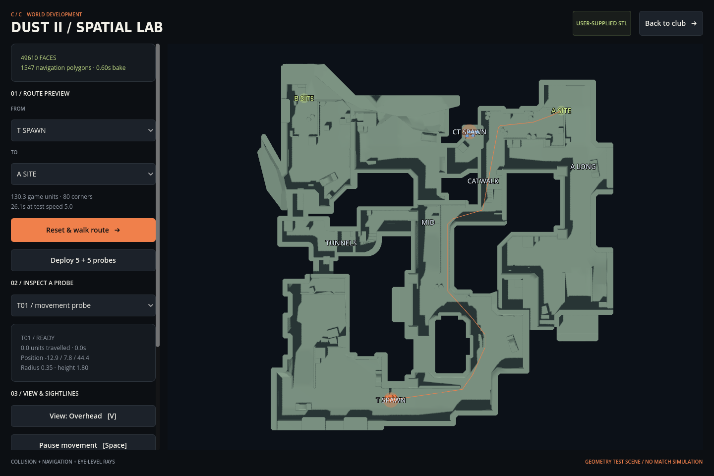

# Dust II spatial foundation

For the automatic played-match implementation built on this world, see [alpha 0.2](ALPHA_0_2.md). The developer lab described here remains a separate geometry tool.

The uploaded `de_dust2+CS2+map.stl` is integrated into a Godot 3D authoring scene. The supplied inline radar guided orientation and provisional landmark placement. Rendered surfaces, collision, navigation, and sightline tests use the STL geometry; radar pixels do not define collision or connect overlapping floors.



## Open the scene

From the existing game, open **Help & settings → Open 3D map lab**. Or, with Godot data directories configured as in the README:

```bash
cd /workspace/CSTCG
godot --path . --scene res://scenes/spatial_lab.tscn
```

The scene includes the imported 3D map, static triangle collision, derived navigation, T/CT seed markers, A/B seed markers, and ten movement probes. It does not create combat outcomes, bomb events, economy payouts, or match rewards. The club now uses this world in a separate played-match scene; the quick skip simulator also remains available.

## Controls

| Control | Behavior |
| --- | --- |
| From / To selectors | Preview a connected route between authored landmarks |
| Reset & walk route | Explicitly reset the selected probe to the chosen origin, then walk the route |
| Deploy 5 + 5 probes | Replace the group with five clear, separated positions near each spawn seed |
| Probe selector or left-click near a probe | Select the nearest movement probe |
| Left-click a connected surface | Route the selected probe from its present position |
| Shift-click two surfaces | Test a real eye-height ray, draw clear/blocked feedback, and mark the first collision |
| Navigation overlay | Display all baked polygon edges, including disconnected rooftop regions |
| V / view button | Toggle overhead and angled 3D cameras |
| Wheel / middle-drag / F | Zoom / pan / reset the camera |
| Space / pause button | Pause or resume movement |
| Back to club | Return to the existing management prototype |

The map lab is a developer view with explicit visibility overlays. Those overlays are not a competitive spectator information policy. Probes do not yet avoid teammates, make tactical decisions, fire, or represent final player behavior. Reset/deploy are deliberate authoring operations; ordinary route traversal uses collision checks and bounded steps.

## Source preservation and conversion

| Property | Observed value |
| --- | --- |
| Original binary STL | 2,481,884 bytes, 49,636 triangles |
| Source SHA-256 | `4cd8a27780b5cd3f3c8d1159bd113b103eb3fa95a492c86a2ecfda629695de2c` |
| Source bounds | X −82.5901…89.6195, Y −100.5857…76.6679, Z 3.6249…27.8935 |
| Converted geometry | 49,610 faces; 24,872 exactly shared vertices |
| Excluded faces | 26 zero/near-zero-area triangles; original source retains them |
| Navigation bake | 1,547 polygons with the current parameters/runtime |

`assets/maps/dust2/source.stl` preserves the uploaded bytes. `dust2.obj` is generated by `tools/convert_dust2.py` using only Python's standard library. `manifest.json` records source/OBJ checksums, bounds, axis conversion, scale, and cleanup counts. Conversion does not fill holes, open doors, add floors, or invent connectors. Numerically identical coordinates are shared; nearby unequal coordinates are not tolerance-welded.

Reproduce the conversion from the retained source:

```bash
python3 tools/convert_dust2.py assets/maps/dust2/source.stl
godot --headless --path . --editor --import
```

The converter refuses to replace the retained source with different bytes. Repeating it with the same source reproduces the same OBJ and manifest.

### Axes and provisional scale

The STL is Z-up and has no unit declaration. Center its XY extent, place its lowest Z at zero, then map into Godot:

`X = (source_x − center_x) × 0.6`

`Y = (source_z − min_z) × 0.6`

`Z = −(source_y − center_y) × 0.6`

The factor 0.6 is a provisional gameplay calibration, not an official Source/CS2 unit conversion. The transformed model is about 103.3 × 106.4 game units horizontally and 14.6 vertically. Movement timing is not certified CS2 timing.

`landmarks.json` stores eight provisional source-space seeds: T spawn, CT spawn, A, B, Mid, Catwalk, A Long, and Tunnels. They are near actual walkable surfaces and tested for clearance/connectivity. They are not final spawn volumes, plant volumes, tactical zone boundaries, or an official map-semantic dataset. An early CT candidate landed on isolated geometry; the retained seed was moved to nearby connected ground rather than adding an artificial path.

## Movement and navigation contracts

The same converted face set feeds rendering, static concave collision, and Recast navigation. Baking reads retained CPU faces rather than repeatedly parsing GPU meshes. The scene waits for a usable, synchronized navigation region before exposing routes.

| Parameter | Current setting |
| --- | ---: |
| Player radius / body height | 0.35 / 1.8 game units |
| Eye height above the supported feet position | 1.55 |
| Navigation radius / required height | 0.5 / 1.875, conservatively voxel-aligned |
| Horizontal / vertical voxel | 0.25 / 0.125 |
| Maximum climb / slope | 0.5 / 46 degrees |
| Test movement speed | 5.0 game units per second |

Navigation gives a candidate route, not permission to pass through walls. Each movement step samples actual floor support across the capsule footprint, checks slope and maximum rise/drop, tests destination capsule clearance, and sweeps vertical/horizontal motion through map collision. Footprint support covers ascent and descent without clipping a stair riser. Probes reach path corners before changing direction, avoiding early corner cuts. Unsupported or blocked movement stops with a reason; it does not snap to another floor or a distant node.

Void inputs more than 0.75 units from a navigation surface are rejected. Rooftops can be present as disconnected baked islands, but an unreachable click does not teleport a probe there. Sightline rays use actual supported eye positions, return the first mesh hit, and have no artificial weapon-distance rule. The played-match engine adds ray-based perception, smoke occlusion and simplified weapons. Penetration, recoil patterns and competitive spectator fog of war remain later systems.

## Validation evidence

`bash tools/check.sh` runs existing gameplay/UI checks plus the new spatial tests and map-viewer smoke flow. Each stage must produce its completion marker, so a timed-out scene or unexecuted smoke cannot count as success.

Twelve routes were physically traversed using the player-sized collision probe, with per-step horizontal bounds, vertical-step bounds, and capsule-clearance checks:

| Route pair | Direction 1 | Reverse direction |
| --- | ---: | ---: |
| T spawn ↔ A | 26.28 s | 26.38 s |
| T spawn ↔ B | 22.33 s | 22.43 s |
| CT spawn ↔ A | 9.42 s | 9.42 s |
| CT spawn ↔ B | 13.85 s | 13.97 s |
| A ↔ B | 21.87 s | 22.00 s |
| Mid ↔ Catwalk | 10.50 s | 10.75 s |

These are simulated traversal times at the test speed, not benchmark wall times or official route timings. The largest observed single vertical step was about 0.393, below the configured 0.5 bound. The suite also verifies source/OBJ hashes, seed clearance, real floor support, clear/blocked rays, floor occlusion between elevations, and void-input rejection. Thousands of assertions include per-step checks; they are not thousands of independent scenarios.

The viewer smoke deploys ten probes, uses the route controls, traverses a route, selects a probe through viewport input, tests an occluded Shift-click ray, toggles cameras/navigation, pauses/resumes, and checks the club data is untouched. Graphical captures are reviewed using Mesa software rendering; platform exports and broad GPU compatibility are not established by this.

## Match layer

The [alpha 0.2 engine](ALPHA_0_2.md) now connects ten card-driven agents, perception, purchases, combat, utility and the bomb objective to full MR12/MR3 matches and the manager's rewards. It validates and caches travel tracks through this world interface. Match spawn formations and provisional plant volumes are derived around the retained seeds. The developer lab remains useful for inspecting geometry independently. Refine map semantics, collision avoidance and tactical behavior before treating this as an accurate CS2 simulation.
