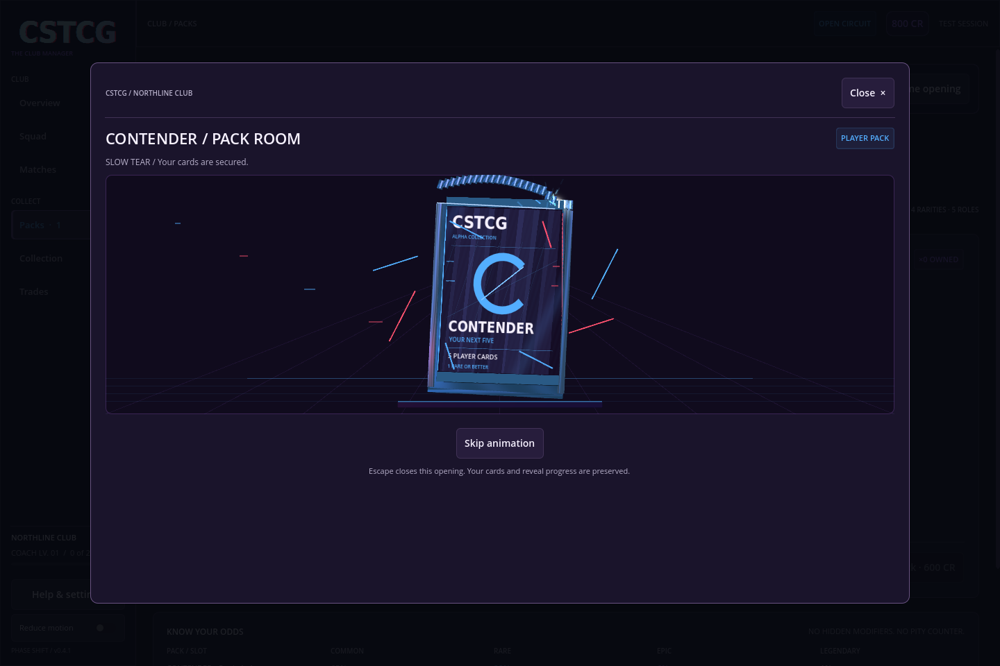
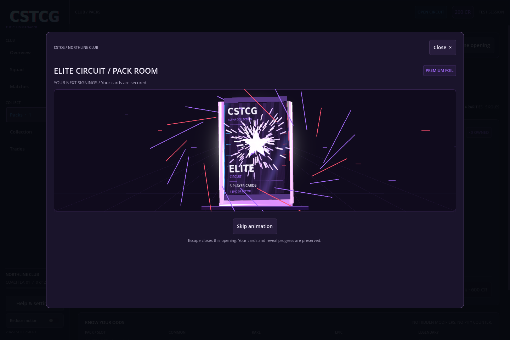

# Alpha 0.4.1 · Slow tear and explosive reveal

Pack opening now builds through five explicit presentation steps: charge, slow tear, energy release, card fan and a settled reveal state. The seam peels progressively from left to right before the explosion starts.

- **Contender:** a 0.4-second charge, 1.35-second tear, blue-white seam glow and sparks, then a shockwave and outward burst into the concealed card fan.
- **Elite Circuit:** a 0.8-second charge and 2.05-second tear, brighter violet foil/lighting, a denser spark shower and a longer flourish. Its original premium crest and extra orbiting fragments remain.
- **Tearing:** the separate crimp is divided into physical segments that lift and curl as the tear travels. A bright crack and local halo follow the tear tip.
- **Explosion:** an expanding light ring, outward flying fragments and a deterministic spark burst accompany the wrapper leaving the stage. The spark budgets are 72 for Contender and 136 for Elite, plus smaller seam-trail pools.
- **Reveals:** individual card flips get a local rarity-colored glow and a short spark accent. Names and values remain readable after the flourish settles.
- **Audio:** the foil rip follows the slower motion. Separate original burst sounds mark the energy release, with a richer resonant finish on Elite.

The glow uses additive local geometry compatible with the existing GL Compatibility renderer. Spark pools use MultiMesh batching. The update does not require a renderer switch or full-screen bloom.

**Skip animation** finishes the current transition and clears its transient effects. Skipping the tear/burst reaches concealed sleeves; it does not reveal an unrequested card. **Reduce motion** retains immediate static states. Closing during charge, tear, burst or a flip preserves secured contents and committed reveal progress. Existing pack prices, odds, contents, rewards and club saves are unchanged.

The pack smoke check now verifies the stage order, a tear lasting at least 1.25 seconds, the longer premium buildup, concealment until the fan, and interruption/resume during both tearing and explosion. It also checks clearing effects when skipping the burst. Existing full-reveal, flip-resume, reduced-motion and lightweight fallback checks remain.

To record an actual graphical preview, run with `--fixed-fps 30 -- --ephemeral --pack-smoke --record-packs --capture-dir=...`. Encode the `movie_%04d.png` sequence at 30 fps. The captured animation contains the real game meshes, shaders and effects.
