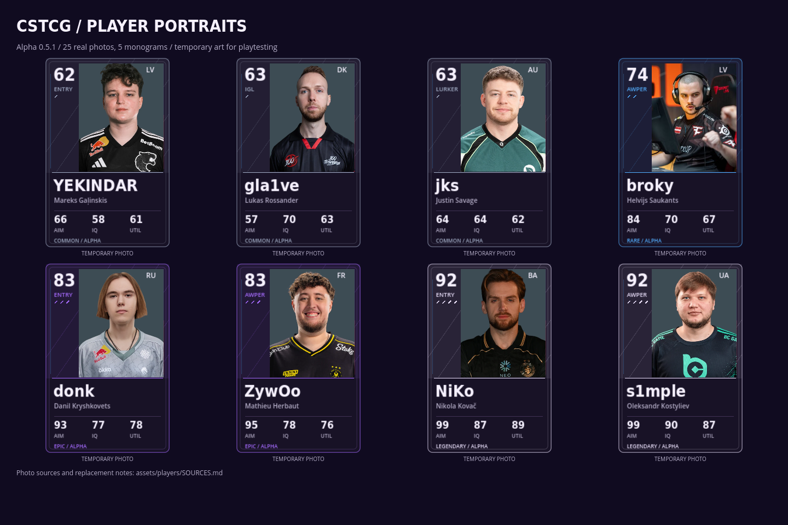
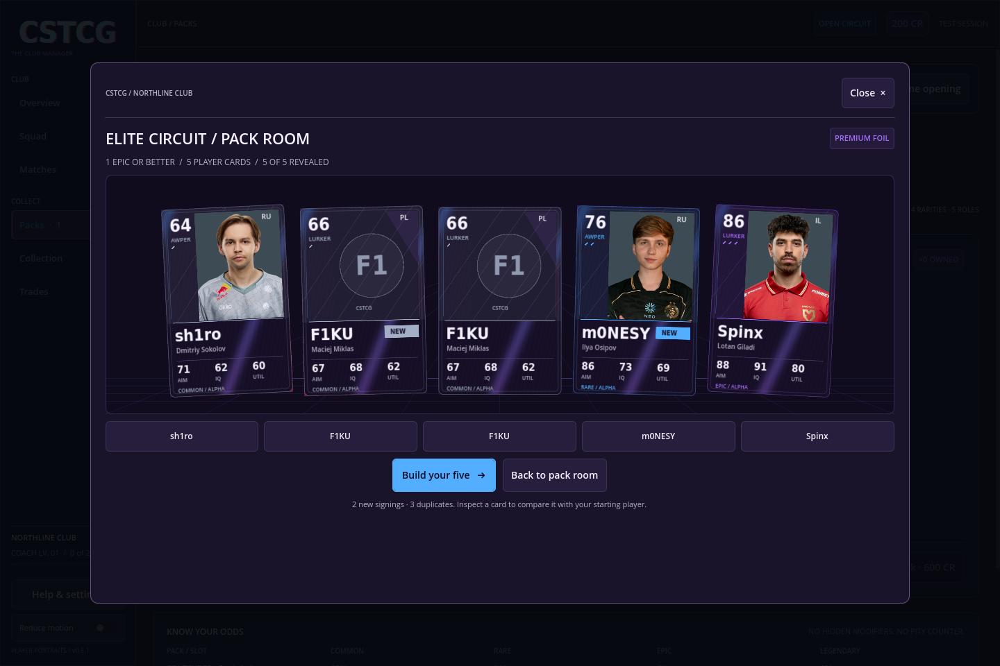

# Alpha 0.5.1 — temporary real-player portraits

The playable cards now use 25 real-player photos across the squad, collection, profile inspector and animated pack reveals. Source image bytes and photographic faces are preserved. Existing rarity frames, foil protection and pack-specific backs surround the photos.

The user requested available headshots now and a later revision. These provisional photos retain their source jerseys; the plain-jersey cutout treatment remains a later art pass. The game bundles all images locally and needs no access to a photo website during play.

## Coverage

**Photographs:** YEKINDAR, gla1ve, jks, rain, sh1ro, XANTARES, broky, siuhy, Perfecto, ropz, EliGE, m0NESY, karrigan, Xyp9x, NertZ, donk, ZywOo, Aleksib, Magisk, Spinx, NiKo, s1mple, FalleN, Twistzz and GeT_RiGhT.

**Monograms:** syrsoN, RUSH, ALEX (Alex McMeekin), interz and F1KU. A source image of another professional named alex was excluded.

Twenty-four profile portraits come from pinned public photo bundles in `Xocks/cs-portraits`; broky's event photo comes from `ValuIancu24/cs2-fantasy-app`. [Photo credits](../assets/players/SOURCES.md) and the [per-file manifest](../assets/players/portrait_sources.json) record source revisions, hashes, original links and changes. No photography license is inferred from the repositories' code licenses or another owner's permission claims.

## Replacing temporary art

The card renderer prefers `.png`, then `.webp`, then `.jpg` for the same canonical filename. A later reviewed transparent PNG overrides the temporary image without a save migration. Old match snapshots with JPEG paths find the new WebP too. Missing photos use the existing neutral monogram.

This update changes presentation: the thirty player definitions, custom stats, pack pools, odds, prices, inventory and save schema are preserved. The four Series 1 products remain a design kit.

## Visual review





Generate the actual card sheet on a graphical display:

```sh
godot --path . --audio-driver Dummy --script res://tools/capture_player_gallery.gd -- --ephemeral
godot --path . --audio-driver Dummy --script res://tools/capture_player_gallery.gd -- --ephemeral --all
```

The capture verifies imported textures, actual rendered photo pixels, the installed/fallback roster and old JPEG-path compatibility. Test collection/profile navigation and Contender/Elite reveals with 3D, reduced motion and 2D previews. The renderer retains each portrait resource between redraws so photos remain visible when a card face is captured for its 3D material.
