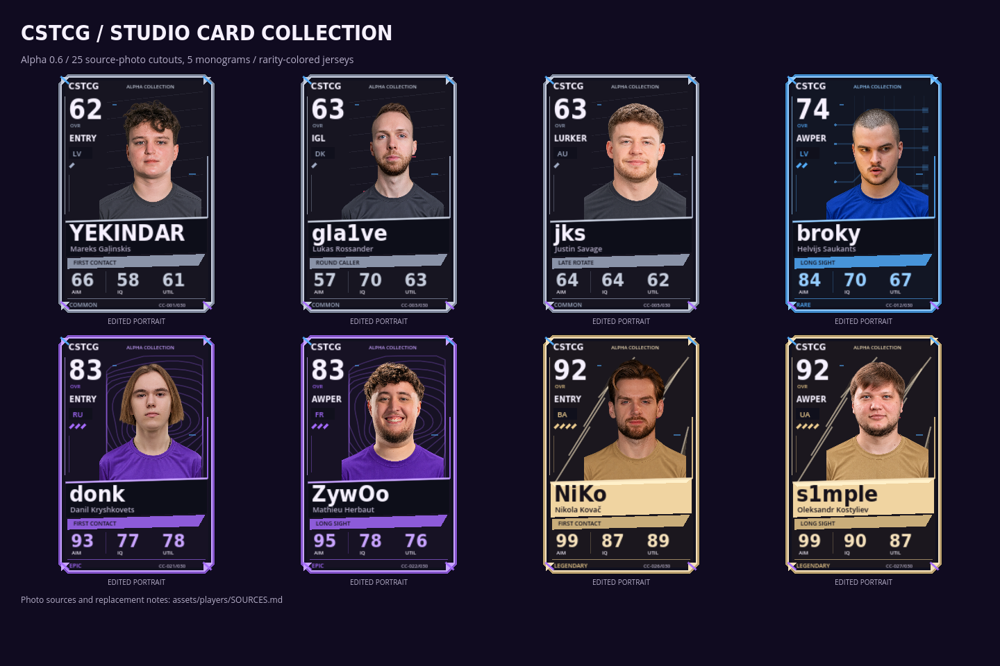
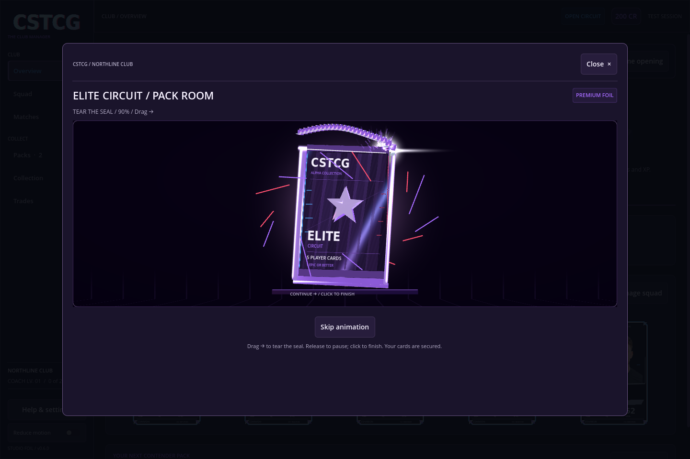

# Alpha 0.6 — Studio Foil

The concept-card direction now drives the playable cards: faceted metal corners, rarity-specific circuit/contour/shard artwork, larger transparent portraits, a slanted nameplate, prominent ratings and live printed stats. Common uses steel/graphite, Rare blue, Epic purple and Legendary champagne. Small red/blue interference marks preserve the Phase Shift palette. Role slogans on the ribbons are cosmetic.

## Open with the pack itself

- **Click** the displayed wrapper to run the slow tear and burst.
- **Hold and drag right** across the seal to control the tear directly. Let go to pause, then continue dragging or click to finish. Dragging backwards cannot reseal it.
- **Enter, Space or Tear open** remain accessible alternatives. Skip animation finishes the current transition.
- The torn edges grow brighter as the tear advances. Curled foil sections expose their metallic undersides, with hotter local glare, crossed lens streaks, foil fragments and sparks. Elite retains a longer automatic buildup and denser effects.

Mouse/touch input remains captured beyond the wrapper. A second touch cannot take over. Focus loss pauses a manual tear; closing cancels its visual session. Reopening a pack with no cards revealed starts its wrapper again using the same secured contents. The partial wrapper tear itself is a local visual state, not a saved inventory state.

Reduce motion suppresses the animated flashes, sparks and flares. The 2D fallback supports the same click/drag controls and a drawn glowing tear.

## Portraits

Twenty-five installed source photos were edited with the image tool into head-and-shoulders PNGs with true alpha transparency and plain rarity-colored jerseys. Likenesses are reviewed against the source photos. These are AI-assisted edits, not unchanged or pixel-identical photographs. No team or sponsor graphics are part of the new jersey design.

The same five missing-source players retain monograms: syrsoN, RUSH, ALEX (Alex McMeekin), interz and F1KU. No substitute professional is attached to those names. [Credits and edit notes](../assets/players/SOURCES.md) and the [per-file manifest](../assets/players/portrait_sources.json) distinguish original sources from edited assets.

Full-resolution source outputs are retained; Godot imports textures at up to 768px with mipmaps. Canonical PNGs also resolve for older frozen match snapshots requesting JPEGs.

## Game state

The thirty player definitions, custom stats, two pack products, prices, odds, save schema and rewards are unchanged. Pack origins still choose the unique backs. All gestures drive presentation of already secured contents; they do not spend, draw, reroll or reveal cards. Reveals continue to commit through the existing game-state transaction before a flip begins. The four Series 1 products remain design specifications.

## Review

The 3D preview uses an opaque studio backdrop so additive light remains visible outside the object silhouette in the GL renderer. The automatic opening and interactive tear share the same burst/fan sequence, with enough camera headroom for the peeled seal.

The portrait gallery checks imported alpha, opaque subjects, old paths and actual rendered photo pixels. The gesture tests cover clicks, jitter, partial tears, monotonic progress, pointer ownership and focus cancellation. The full pack smoke also exercises real stage signals, mouse and keyboard opening, paused/reversed drags, touch capture outside the wrapper, skips, interrupted sessions, inspection, reduced motion and the 2D fallback. It asserts that contents and gameplay RNG are preserved.

`tools/capture_interactive_pack.gd` records a mouse drag routed through the viewport, a partial release/pause, a second drag, the burst and all five reveals. It requires a graphical renderer and `--ephemeral`; its 407-frame run checks that the mouse actually captured the wrapper and that the contents/RNG remain unchanged.
