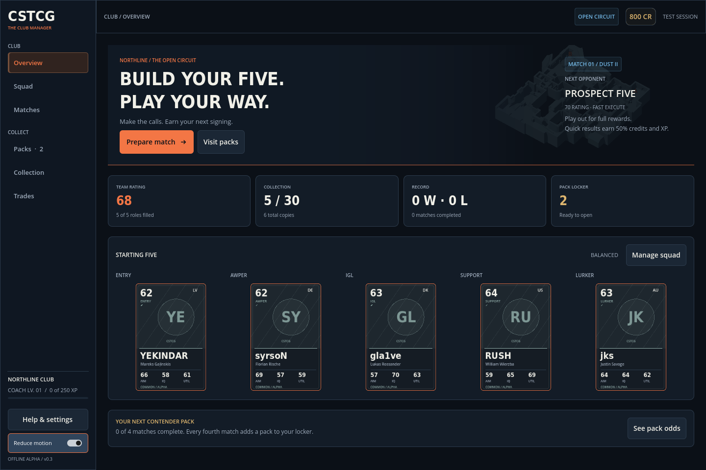
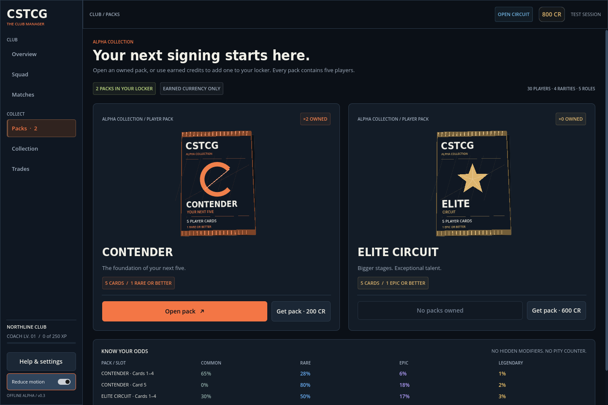
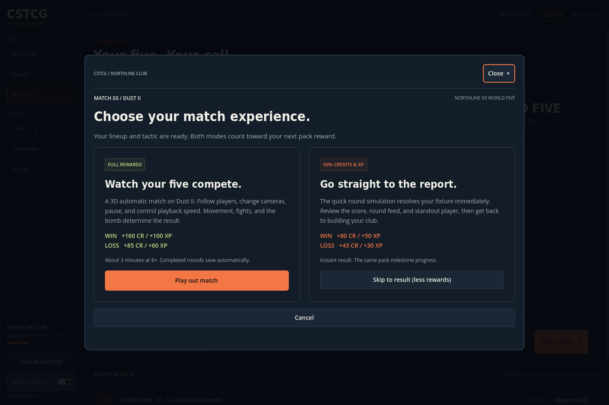

# Alpha 0.3 · Club menu refresh

The club menus now share CSTCG branding, a graphite palette, orange primary actions, blue collection accents and gold premium-pack treatment. This pass improves the existing playable alpha; it does not install the proposed Series 1 catalogue.

## Menus and presentation

- Navigation groups Overview, Squad and Matches under the club, with Packs, Collection and Trades together below. Credits, save status, coach level and pack count remain visible.
- Overview puts the next fixture, starting five and next pack reward together. Dust II artwork is rendered from the same supplied geometry used in played matches.
- Cards have consistent frames, rarity marks, printed identifiers and neutral player monograms. Contender and Elite Circuit have distinct printed foil wrappers. All displayed ratings, card counts and guarantees come from the playable catalogue.
- Collection supports handle/name search, role/rarity/ownership filters, sorting and a clear empty state. Click a card to inspect its identity, three alpha attributes, ownership and lineup status.
- Dialogs are centered and bounded, with visible keyboard focus, Tab containment, Escape dismissal and focus restoration. Pack and match actions fit at both supported window sizes.
- Layouts resize between 1100×740 and 1440×960 without reducing text size. Long pages scroll vertically. Reduce motion is saved between normal sessions.
- The developer map lab is available through Help & settings. The match setup uses an actual Dust II preview.

## Implementation corrections

Pack purchases, trades, releases and lineup edits clearly show when an unfinished reveal or active fixture locks them. A pending opening has a persistent resume action. Closing during the tear animation cancels its callback, preventing a dismissed dialog from reopening; the secured contents and reveal position survive dismissal.

Deferred dialog focus uses a weak reference, preventing attempts to focus controls destroyed during quick transitions. Search keeps typing focus as results update. Old notifications clear when a dialog opens so they do not obscure its actions. Save failures use an explicit unsaved status.

## Verification and boundaries

The existing gameplay, persistence/migration, map navigation, causal match and UI suites cover this build. The UI smoke flow additionally checks both window sizes, search, player inspection, focus containment/restoration, visible dialog actions, opening interruption/resume, purchases, trades and both report paths. Graphical review uses Linux/Mesa; export validation exercises the Linux executable and Windows resource pack. Native Windows execution still needs a tester.

The runtime still contains **30 players and two five-card alpha products**, Contender and Elite Circuit. The four Series 1 products, 60 identities, alternate editions and revised rarity/stat model remain in the [design kit](series_1/DESIGN_SPEC.md). Player photos are not bundled. Save schema, inventory, odds, prices, reward calculations and the two match engines are unchanged by this pass.
