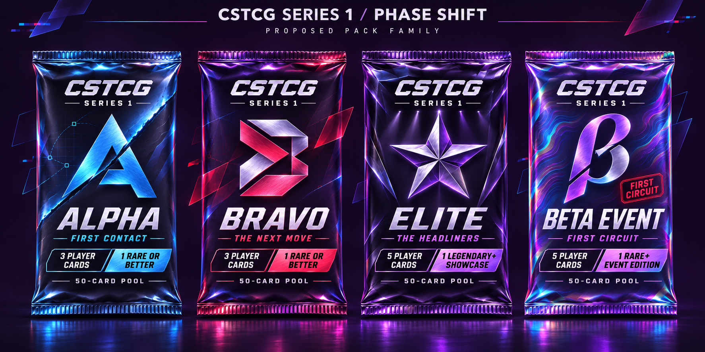
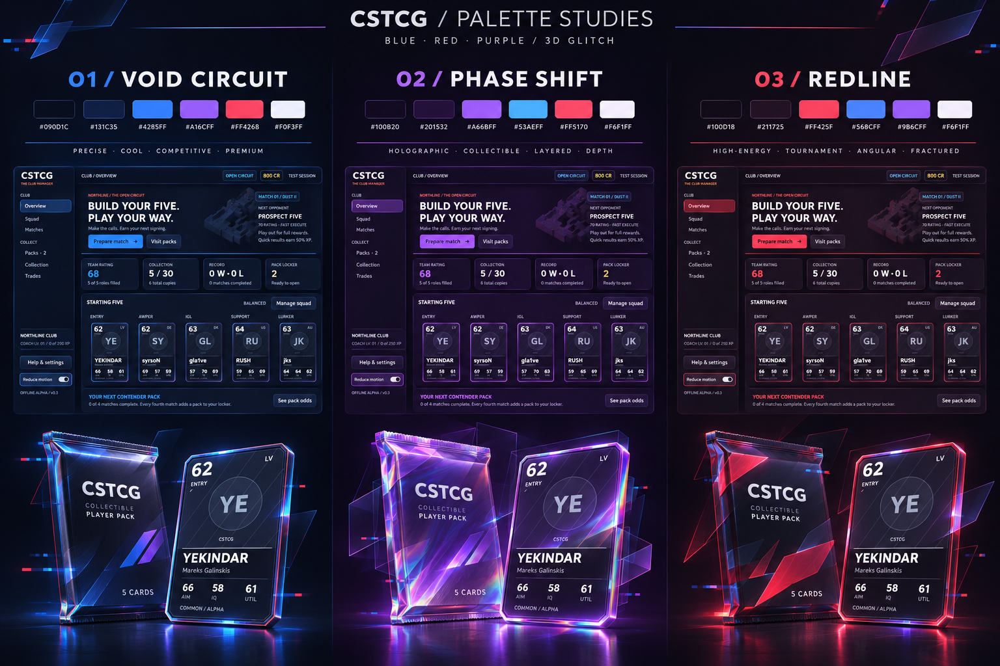
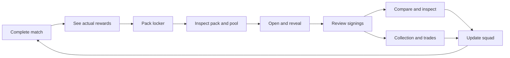

# CSTCG · Phase Shift integration proposal

**Status: visual milestones A–C approved.** The user approved this direction and requested more flavor and flair for expensive pack openings. The implementation is documented in [alpha 0.4](../ALPHA_0_4.md). The four-pack images remain concept references; Series 1 catalogue activation is still milestone D. The original proposal follows for context.

## Recommended direction

Give the club a dark violet identity, use blue for primary interaction, and reserve red for product accents and match emphasis. Put the richest materials and spatial effects on the objects players collect: wrappers, cards, edition finishes and rewards. Everyday squad management should remain clear and quick.

The club should feel like a coherent home for the packs. The same CSTCG mark, foil seams, broken-plane geometry and edge lighting should recur in the locker, opening stage, card inspector and match-reward presentation.

These images establish composition and material direction. They are concept references, not final production textures or screenshots of a new build. The production version would use separate material, artwork and text layers.

## What exists today

The inspected alpha 0.3 has six working club screens, thirty player definitions, four rarities and two five-card products: Contender and Elite Circuit. Packs and cards are procedurally drawn 2D controls. Pack tearing currently scales and fades the wrapper. The collection is searchable and cards have read-only inspection. Pack outcomes are secured before the animation and can resume after dismissal or restart.

The four requested Series 1 products are fully specified in the design kit, but are not installed in the runtime. Its proposed sixty players, ninety collectible definitions, three-/five-card openings, six rarities, editions and eight-attribute profiles require more than new wrapper artwork. Both state validation and the opening UI currently assume five cards.

## 1. Give every color a job

| Role | Proposed color | Use |
| --- | --- | --- |
| Background | Plum-black `#100B20` | Main canvas, modal dimming and opening stage |
| Surface | Deep violet `#201532` | Panels, locker tiles and inspector backing |
| Brand | Violet `#A66BFF` | CSTCG accents, section detail and holographic finish |
| Primary action | Ice blue `#53AEFF` | Prepare match, open pack, reveal, focus and selected controls |
| Impact | Signal red `#FF5170` | Bravo identity, opponent/loss indicators and clearly labelled alerts |
| Main text | Near-white `#F6F1FF` | Names, statistics, headings and body copy |
| Secondary text | Lavender-gray `#B5AEC8` | Supporting labels and captions |

Most pixels remain dark and neutral. Highlights mark interaction or an object of interest. Use white on dark surfaces and dark ink on bright filled buttons; test actual contrast in each state. Product color, card rarity and ally/opponent identification remain separate concepts, each supported by a written label or symbol.

## 2. Reinterpret the four pack designs

Keep the existing product names, shared pouch proportions, wordmark position, emblems, opening sizes, pool membership and guarantee hierarchy. The following recolors are proposed replacements for the orange/blue/gold/mint treatments in the existing design kit.

| Product | Proposed finish | Recognizable geometry | Contents specified in the design kit |
| --- | --- | --- | --- |
| CSTCG Series 1 Alpha | Ice-blue foil over navy-black | Split A, one forward slash, blue wireframe echo | 3 cards; 50-card pool; Rare+ final slot |
| CSTCG Series 1 Bravo | Red foil with blue/violet reflections | Folded B, paired chevrons, short displaced planes | 3 cards; 50-card pool; Rare+ final slot |
| CSTCG Series 1 Elite | Violet-black glass with silver chrome | Faceted five-point crest, precise layered reflections | 5 cards; 50-card pool; Legendary+ Showcase final slot |
| CSTCG Series 1 Beta Event | Blue/violet interference foil, red event stamp | Split beta glyph, contour film and event ribbon | 5 cards; 50-card pool; Rare+ Event edition final slot |

All four use one reusable 3D pouch model, with four material/artwork sets. Distinct emblems and finishes keep Elite and Beta Event recognizable even though both use violet. Card count, eligible-pool count, guarantee and owned quantity are explicit. Price and acquisition status remain live UI text.

Alpha/Bravo shared cards retain one card identity and appearance regardless of which wrapper produced them. A product's blue or red wrapper does not recolor a player's stats or create an extra edition.

During the visual-only milestone, the two existing alpha products retain their names, quantities and contents. They can adopt blue Contender and violet Elite Circuit materials. The Series 1 family can be reviewed in a labelled design preview before it becomes an obtainable catalogue.

## 3. Map the identity across the game

| Surface | Proposed change | Effect intensity |
| --- | --- | --- |
| Global shell | New theme tokens; blue focus/action states; violet branding; coherent selected/disabled states | Minimal; readable and still |
| Overview | Keep the current club layout; add a dimensional CSTCG emblem, quiet offset map silhouettes and an actual next-pack reward preview | Low, behind content |
| Squad | Clean card tiles, role labels and an understated selection edge; open the richer inspector on demand | Low |
| Pack locker | Owned-pack shelf, larger selected preview, product identity, opening size, guarantee, odds and pool details | Medium on selected pack only |
| Collection | Static card grid with clear rarity and edition labels; collection-progress filters when Series 1 is activated | Low; no simultaneous animated card wall |
| Card inspector | Tilt, card thickness, reflective foil and an optional front/back view; keep identity and values sharp | Medium on one selected card |
| Opening stage | Dedicated 3D pack, seam tear, card fan, individual reveals and reveal-all | Highest, player initiated |
| Pre-match choice | Recolor the existing two choices; add a restrained dimensional team-card composition | Low |
| Played match | Recolor the HUD and labelled ally/opponent markers; retain the readable Dust II world, score, timer and controls | Minimal during play |
| Match report/rewards | Present the actual earned credits/XP and any genuinely awarded pack using the same wrapper asset | One brief reveal |
| Trades | Clean give/receive framing, readable card inspection and a short confirmation accent | Low |
| Help/settings | Explain motion behavior and retain the existing map-tools access | Still |

The collecting/management loop becomes:

Existing reward amounts and milestones remain intact in the visual update. The result screen should show a pack only when the saved result actually awards one.

## 4. Make opening a pack the visual centerpiece

1. **Select.** The locker shows the sealed pack, owned count, opening size and guarantee. Details exposes the real pool and slot odds.
2. **Stage.** The selected pack appears above a dark reflective plinth. A small cursor tilt reveals foil and physical thickness. Open controls stay in crisp UI outside the effect layer.
3. **Tear.** A top seam separates, with a short displaced-edge glitch and foil-tear sound. Target ordinary transitions at roughly 0.2–0.4 seconds.
4. **Fan.** Three or five matching concealed sleeves move into place. Sleeves do not reveal rarity, edition or identity. The guaranteed slot stays last.
5. **Reveal.** A click flips one card into a readable frontal hold. Its real rarity and edition determine the finish and accent. A higher-rarity flourish may last around a second and remains skippable.
6. **Review.** Show the actual cards and clear new/duplicate labels. In Series 1, distinguish NEW PLAYER, NEW EDITION and DUPLICATE. Inspect or compare a signing before adding it to the matching lineup role.
7. **Continue.** Return to Squad, Collection or the locker. Reveal-all remains available throughout the unrevealed sequence.

The visual scene reads the existing secured result; animation never rolls, grants or settles cards. Closing during any effect or restarting resumes the same reveal. Reduced motion goes directly between static wrapper, sleeve and readable card states with the same controls and result.

## 5. Define the glitch motif precisely

- **Spatial depth:** raised print, thin card edges, foil layers, an extruded CSTCG emblem and cursor parallax on the selected object.
- **Displacement:** a few fragments or wireframe duplicates move slightly out of alignment around the object during hover, tear and reveal.
- **Chromatic edges:** subtle red/blue ghost edges behind artwork and seams; keep names, faces and statistics on the unaffected text/portrait layer.
- **Material response:** violet interference foil catches blue and red reflections as the object tilts. Edition finishes can add contour film or black glass without obscuring rarity.
- **Rhythm:** most UI stays still. Short, deliberate effects respond to actions; ordinary browsing does not continually jitter.
- **Audio:** restrained foil tearing, card contact and a short electronic accent support the motion. Audio is supplementary to visible labels.

Reduce motion removes tilt, drifting fragments, abrupt displacement and animated chromatic separation. A static foil treatment retains the art direction. Focus indicators, contrast and written rarity/edition labels must work independently of effects.

## 6. Build it in reviewable milestones

| Milestone | Concrete deliverable | Relative scope |
| --- | --- | --- |
| A · Theme and art proof | Palette applied to the six menus; one production-ready pack and card material; four-pack artwork proofs; before/after captures at both window sizes | Small–medium |
| B · Working 3D opening | Reusable opening scene on the current alpha packs, including tilt, tear, fan, individual reveal, reveal-all, static mode and exact resume | Medium |
| C · Connect the club loop | Selected-pack locker preview, matching card inspector with same-role comparison, honest reward presentation, consistent trades and match HUD, verified portable builds | Medium |
| D · Activate Series 1 | Install the four products and versioned pools, variable opening sizes, six rarities, sixty profiles/ninety definitions, editions, eight-attribute inspection/behavior integration and save migration | Large; separate content/gameplay milestone |

**Recommended initial implementation scope: A–C.** This delivers a coherent visual update and a real working opening sequence that can be judged before committing to the larger Series 1 content release. Milestone D is needed to make the four named products obtainable with their designed contents; it is not implied by approving new colors.

For D, preserve existing cards and unopened packs as legacy products, preserve credits/history and any in-progress reveal or match, back up saves before migration, and enforce one professional per lineup across editions. Recheck both simulation paths against the intended eight-attribute model. Prices, published odds and event milestone candidates require explicit content/balance review before activation. A recolor must not silently change the collection economy.

## 7. Godot implementation approach

Keep the current GL Compatibility renderer. Use lightweight geometry, controlled material highlights and environment lighting; the proposal does not depend on ray tracing or a renderer change. The live 3D showcase exists only for the selected pack, inspector or opening. Most collection/squad tiles use cached/static artwork. Hidden scenes stop animating, and the 3D opening releases its resources when dismissed.

| Existing area | Intended implementation change |
| --- | --- |
| `scripts/ui.gd` | Semantic palette tokens and component states; replace scattered orange/gold UI accents consistently |
| `scripts/pack_art.gd` | Keep a lightweight shelf/fallback renderer; read product visual metadata instead of selecting only two hard-coded styles |
| `scripts/card_art.gd` | Shared readable frame/text layers plus an optional isolated foil/effect layer; preserve current identity/stat sources |
| `scripts/arena_art.gd` | Brand/map background treatment behind the readable menu surface |
| `scripts/main.gd` | Integrate dedicated showcase/opening scenes, preserve current focus/close/resume handling, and reuse the same assets on rewards |
| New UI scenes/materials | One pack mesh, one card mesh, reusable stage lighting, product skins, foil masks and bounded glitch effects |
| `scripts/spatial/played_match.gd` | HUD and labelled marker colors; keep causal simulation separate from presentation |
| Catalogue/state/tests | Required for D: definition IDs, variable slot counts, edition/identity separation, exact guarantees and deterministic migration |

Keep handle, statistics, ownership, opening size, guarantee and prices as authoritative live text. Concept renders are not used as a flattened replacement for working controls or variable game data. Continue using neutral player identity artwork until final player portrait assets are supplied.

## 8. Acceptance before a playable handoff

- All six menus, the inspector and primary opening/match actions fit at 1100×740 and 1440×960.
- Keyboard focus, Escape dismissal and return focus continue to work through 3D transitions.
- Closing/reopening during tear, fan, flip or review preserves exactly the same cards and reveal progress, with no late callback reopening a dismissed window.
- Reveal-all and reduced motion provide the same result and can be used without waiting through effects.
- Rarity, edition, ownership, opening size and guarantee remain clear regardless of product color.
- Ordinary management retains responsive scrolling and input. Measure the 3D prototype before increasing material/effect cost, and retain a static fallback.
- Existing gameplay/save, map and causal-match checks pass, plus focused tests for any new opening-state transitions. Exported resources include every mesh, material and shader required by the selected path.
- Review Linux graphical output and both exported resource packs; record native Windows rendering as separately verified only after an actual Windows run.
- For D, separately validate pool counts, exact odds, three-/five-card outcomes, edition parity, legacy saves and the event reward rules before enabling the new packs.

## Proposed decision

Review the Phase Shift palette, Alpha-blue/Bravo-red/Elite-violet/Beta-iridescent family, and A–C implementation scope together. The next concrete deliverable after approval would be the applied theme plus one working pack/card art proof, followed by the reusable 3D opening. The complete Series 1 activation remains visible as milestone D for its own scope decision.
